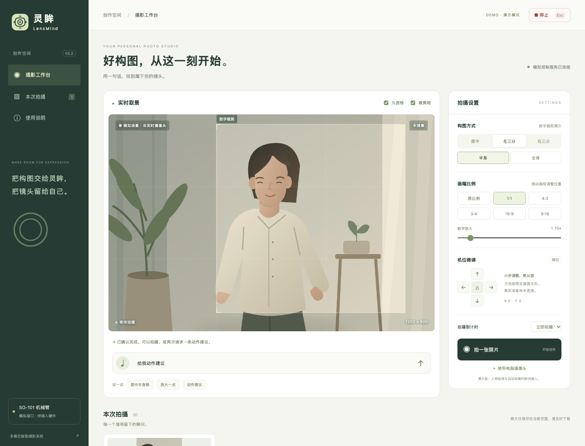

# 灵眸 LensMind

多模态感知驱动的交互式智能摄影系统。当前仓库为 **V0.2 协作起步框架**，面向室内单人定点人像，使用 Spring Boot 托管原生 Web 前端。



## 快速开始

本地实时 ASR 需先启动独立服务。首次拉取安装 Git LFS 并执行 `git lfs pull`，再按 [本地 ASR 启动与交接](docs/LOCAL_ASR.md) 安装固定 Python 依赖、校验权重和启动 `asr/local_asr_server.py`。识别服务默认 8766，网页仍为 8080；若只体验文字与模拟拍摄，可先不启动 ASR。

需要 **JDK 17 或以上**；仓库自带 Maven Wrapper，无需另装 Maven、Node.js 或数据库。首次运行需要联网下载 Maven 与依赖。

```bash
cd /你的路径/lensmind
./mvnw spring-boot:run
```

Windows 使用 `mvnw.cmd spring-boot:run`。浏览器访问 <http://localhost:8080>。如果提示没有 Java，请安装 JDK 并配置 `JAVA_HOME`，或在 IDE 里选择项目 JDK。

```bash
# 测试、打包
./mvnw test
./mvnw package
java -jar target/lensmind-0.0.1-SNAPSHOT.jar
```

默认仅监听本机。端口可通过 `PORT=8081 ./mvnw spring-boot:run` 修改。摄像头与麦克风需要 localhost 或 HTTPS，以及浏览器授权。不要直接双击 HTML；页面依赖同源 `/api` 接口。

从项目根目录启动。若 IDE 编译 Java 后没有复制 `application.properties`，入口会在类路径确实缺少该文件时，补充读取 `src/main/resources/`，避免因 `lensmind.ai.allowed-hosts` 等配置未加载而启动失败；正常类路径及打包 JAR 沿用原加载方式。可运行 `./mvnw resources:resources` 恢复编译资源；不要通过删除域名校验解决缺配置问题。8080 已有本项目服务时直接访问网页，不重复启动第二份。

人物、人脸和姿态模型随仓库检出，位于 `models/`。启动项目后点「开启电脑摄像头」即可体验检测。模型来源和许可见 [本地视觉模型](models/README.md)，启动与验证步骤见 [视觉与语音演示](docs/VISION-DEMO.md)。

### 启动 SO-101 三维仿真

在仓库根目录打开两个终端。仿真服务使用课程提供的整个 `SO101` 模型目录，其中包含 `scene.xml`、机械臂 XML 和网格资源。运行环境需要 Python 3.12、MuJoCo 4.0.0、NumPy、Pillow 和可用的 OpenGL。已有课程 `lerobot` 环境时可直接使用。

第一个终端运行 MuJoCo 服务。把示例路径替换为你的课程场景文件路径。

```powershell
conda activate lerobot
python simulation/so101_server.py --scene '（此处填写 SO101 模型文件夹位置）/scene.xml'
```

macOS 在图形桌面下也可启动 MuJoCo。进入仓库目录并激活课程 Python 环境，用本机的课程模型路径运行。

```bash
conda activate lerobot
python simulation/so101_server.py --scene "/你的课程目录/SO101/scene.xml"
```

终端显示 `SO-101 MuJoCo simulation listening on http://127.0.0.1:8765` 后，保持此终端运行。可在另一个终端执行 `curl -fsS -o /dev/null -w '%{http_code}\n' http://127.0.0.1:8765/status` 检查是否返回 `200`。

第二个终端使用 JDK 17 或以上，启动网页服务。

```powershell
$env:LENSMIND_DEVICE_BACKEND = 'mujoco'
.\mvnw.cmd spring-boot:run
```

在 macOS 的第二个终端可以运行 `LENSMIND_DEVICE_BACKEND=mujoco ./mvnw spring-boot:run`。也可以在 TRAE 的「运行和调试」中选择 **LensMind 三维仿真**，它会启动网页并连接已运行的本机 MuJoCo。

打开 <http://localhost:8080>。主取景区显示腕部相机，操作区默认展开机械臂外部视角。**左转 / 右转** 每次转 1°，**前进 / 后退** 每次沿当前取景方向移动 5 mm，**上升 / 下降** 每次竖直移动 5 mm，**抬头 / 低头** 每次调整俯仰 1°。这些操作可以依次组合。页面显示转向、前后位移、相对高度和俯仰，两处画面同步更新。点「停止」锁定当前机位和帧，点「回初始位」恢复。

这一版采用模型零位、临时相机安装位和 45° 竖直视场角。可用 Python 启动选项 `--fovy` 调整视场角。左右转向由底座旋转实现。平移和俯仰通过课程模型求解肩、肘和腕，分别维持当前朝向或镜头位置。单轴仿真范围为左右各 20°、前后各 40 mm、上下各 30 mm、俯仰各 10°。高位前伸等机位可用的俯仰范围受模型可达性限制，目标不可达时保留当前机位。MuJoCo 服务默认监听本地 8765，可配对设置 `--port` 和 `LENSMIND_MUJOCO_PORT`。默认网页启动使用二维 SVG 模拟器。

### 拍摄前校准 SO-101 从臂

在实际连接机械臂的电脑上启动网页和校准工具。进入包含 `scripts/calibrate_so101.py` 的 LensMind 项目文件夹后，在安装了 LeRobot 的 Python 环境运行 `python scripts/calibrate_so101.py --list-ports`。对比拔插机械臂数据线前后的端口列表可确认本机端口。Windows 示例为 `COM9`，Linux 常见为 `/dev/ttyACM0`，macOS 以本机列出的 `/dev/cu.*` 为准。每台电脑访问自己的 `http://127.0.0.1:8080`。同一个串口在同一时间由一个程序使用。

Windows PowerShell

```powershell
Set-Location '（此处填写 LensMind 项目文件夹位置）'
$env:LENSMIND_CALIBRATION_REQUIRED = 'true'
$env:LENSMIND_CALIBRATION_PORT = '（此处填写本机 SO-101 串口）'
$env:LENSMIND_CALIBRATION_PYTHON = (Get-Command python -CommandType Application).Source
$env:LENSMIND_CALIBRATION_FILE = Join-Path (Get-Location) 'config/so101-calibration.local.json'
.\mvnw.cmd spring-boot:run
```

macOS / Linux 的 Bash 或 Zsh

```bash
cd '（此处填写 LensMind 项目文件夹位置）'
export LENSMIND_CALIBRATION_REQUIRED=true
export LENSMIND_CALIBRATION_PORT='（此处填写本机 SO-101 串口）'
export LENSMIND_CALIBRATION_PYTHON="$(command -v python3)"
export LENSMIND_CALIBRATION_FILE="$PWD/config/so101-calibration.local.json"
./mvnw spring-boot:run
```

在摄影工作台点击「开始校准」，复制页面命令到本机另一个终端。已有实机控制服务时，先确认停止并退出该服务以释放串口，网页可维持运行。也可直接从项目根目录运行 `python scripts/calibrate_so101.py --port "（此处填写本机 SO-101 串口）" --output "（此处填写网页所配置的校准文件位置）"`。输入 `CALIBRATE` 前托稳机械臂。按终端提示手动摆位，工具比对六轴舵机读回值并保存。回网页点击「核验结果」，再确认中立位。重新校准后重新生成与新校准匹配的控制采样文件。

常规重启会重新要求校准。维护时如果需要保留刚刚通过核验的本次记录，管理员可在启动环境中临时设置 `LENSMIND_CALIBRATION_RESUME_SHA256` 为该文件的 SHA-256。应用会比对文件内容并核验六轴结构。此选项仅用于延续本次已核验的记录。

连接 USB 腕部摄像头后，在启动网页服务前将 `LENSMIND_WRIST_CAMERA_LABEL` 设为 Windows 识别到的摄像头名称，例如 `USB CAMERA`。工作台点「开启腕部摄像头」并允许浏览器使用摄像头。指定腕部画面用于预览、取景分析与原片。未连接指定设备时锁住快门。

实机接管需先在舵机卸力时运行 `scripts/sample_so101_yaw.py`，只读记录中立位和现场示范的左右转向边界，每侧最多约 15°。采样与校准文件匹配时可重复使用。启动 `scripts/so101_voice_control.py --port <本机串口> --calibration <已核验文件> --poses <左右采样文件> --listen 8767`，并为它和 Spring Boot 设置同一个本机环境变量 `LENSMIND_SO101_TOKEN`。网页需配置 `LENSMIND_DEVICE_BACKEND=so101`、已核验的校准和腕部摄像头。控制端启动只连接并读取舵机。扶稳机械臂摆到采样时的中立位，点「已保持中立位」和「启用实机语音控制（舵机上扭矩）」后才接管。开启麦克风后说「相机向左转一点」「相机向右转一点」或「停止」。每次转动六个编码器刻度，超出采样范围即拒绝。实机拍摄要求腕部相机可用、机械臂停稳和取景人物稳定。

在拍摄页右上角可点击「取消操控」。网页关闭语音监听并发出停止请求。控制端确认停稳后锁定后续移动，舵机继续保持当前位置。关页也只发送停止。需要卸力时，在「实机操控」点「结束操控并卸力」，确认已经用稳固支撑物托住机械臂。控制端再次核对停稳状态，解除并逐轴核验扭矩，随后继续保持移动锁定。再次接管前需重新确认中立位。

### 六向实机控制的模型依据

校准文件给出六轴的编码器偏移和关节限位，可用于筛除越界目标。上下、前后还需要知道编码器刻度对应的模型关节角、真实腕部相机的安装位置和朝向，以及装台后的可用空间。课程仿真当前使用临时的相机安装位。一次完成这些实机对应关系并现场验证后，可复用配置，在关节校准限位内用逆运动学计算六向小步动作，无需每次拍摄前重新示范方向。当前六向平移与转向在仿真中验证，实机使用已采样的左右微转。

实机控制桥默认使用 8767，本地 ASR 使用 8766，避免两个服务争用端口；自定义控制桥端口时同时设置 `--listen` 与 `LENSMIND_SO101_BRIDGE_PORT`。

## 当前可以体验

**当前语音搭配（2026-11-28）：** 本地 Zipformer 中文 INT8 流式 ASR + 汇云 Qwen LLM + UniAPI Gemini TTS。ASR 无需 API Key，边说边回显中间文字，仅最终句触发指令；识别固定本地，不提供云端或浏览器切换。权重按组长要求使用 Git LFS 随仓库分发。[本地 ASR 启动与交接](docs/LOCAL_ASR.md)。偏好版本为 `speechDefaultsVersion:5`，所有历史 ASR 偏好统一迁移到本地。

- 摄影工作台：默认打开首页。点「开始拍摄」进入拍摄页，可开启电脑摄像头或沿用演示画面。点「完成拍摄」结束取景和倒计时，进入选片与下载页。首页、拍摄、选片和设置在同一标签页内切换，已拍照片会继续保留。
- 统一设置：顶部「设置」或摄影助手的「模型设置」打开 `#settings`，集中管理服务商、API 地址、视觉模型与临时连接，支持测试和断开；预置汇云、UniAPI、致远一号等常用地址，模型必须是服务商实际开通的视觉模型。还可调整播报开关、语速、音量，试听所选 TTS，切换九宫格、裁剪框显示与倒计时。拍摄页保留快门、画幅、构图、机位与麦克风等操作。进入设置会取消倒计时并关闭摄像头和麦克风，返回后需重新开启采集。
- 固定模型方案：默认 LLM/视觉为汇云 `qwen3.5-27b`，基础地址 `https://zgc.apihy.com/v1`（`/v1/models` 为列表地址）。ASR 固定本地 Zipformer 流式中文识别，TTS 继续使用 UniAPI `gemini-3.8-flash-lite-tts`、音色 `Kore`，不需要百炼账号或 Workspace ID；保存时可留空读取本机 `lensmind.uniapi-key`，也可单独输入。TTS 仍可手选现有方案，仅百炼 TTS 需要北京地域 Key 与 Workspace。保存不调用模型，录音/试听才产生调用，失败不自动回退或轮换。详见 [固定模型说明](docs/MODEL_PRESETS.md)。
- 试听反馈：设置页在按钮旁持续显示等待合成、正在播放、结束或具体失败原因；等待和播放时按钮变为「取消试听」，取消后丢弃晚到音频。音量为 0 时提示调高音量且不发起调用；浏览器阻止播放时提示允许本站声音。云端请求最多等待约 70 秒，超时不重试。错误不会只留在隐藏的拍摄页。

设置页采用紧凑字号和间距：字段与正文约 13～14px，卡片标题 17px；接口详情、麦克风设置默认收起，自定义模型会展开接口详情。ASR 固定本地 Zipformer，TTS 保持 UniAPI Gemini，保存反馈缩短，运行状态显示当前选择的语音模型，避免将旧接口的 Whisper / tts-1 配置误作拍摄页当前模型。

设置页试听独立于设备连接，仿真服务断连不会取消试听。主动点击「取消试听」仅显示「试听已停止。」；页面内部清理不再冒充用户取消，也不重复显示计费提示。费用说明保留在语音设置说明中，播放失败仍显示具体原因。
- 模拟取景：默认使用控制端返回的二维 SVG 帧。启用 SO-101 仿真可显示腕部相机和机械臂外部视角。也可授权使用电脑摄像头。模拟预览与原片使用同一帧。
- 数字构图：默认不限景别，半身或全身只作为构图参考，不要求身体部位完整入镜。画幅支持原比例、1:1、4:3、3:4、16:9、9:16。拖框内可移动，拖任一角可缩放。金色引导线和高亮标出目标区域，并随当前画幅移动。拖动、缩放或切换画幅时保留原构图目标，重复设置构图和景别时保留手动裁剪。
- 摄影助手：拍摄页的文字、麦克风和快捷按钮共用一个输入框；未连接模型时隐藏基础模式提示，语音配置说明集中在设置页，操作时配置不可用仅提示「语音配置未就绪」。说「我要拍一张左下四格的照片」可点亮左下四格。说「一比一画幅」会调整实际裁剪框。说「我需要拍一张人物在右下四格的半身照」会同时设置目标和景别。说「已完成」可确认当前动作建议。
- 人物分析：电脑摄像头由本机 Spring Boot + ONNX Runtime 每帧检测最多 8 人。点人物编号，可以用左三分、居中、右三分三个预设，也可以在九宫格里点选任意组合。可以说「人物1左下四格，人物2中上一格」或「让人物的头在右下角」。头部目标由本机 YuNet 以可见脸部中心定位。只有一张脸时，即使只露出头也支持判断。
- 模型交互：从「设置」接入支持图片输入的 OpenAI 兼容 API。连接后，发送的文字和最终语音转写可交由模型理解，包括灯光、衣服、背景和姿势。看图请求可以使用当前画面和参考图。明确的九宫格、画幅及景别以页面实际应用的设置为准，快门和停止口令即时执行。
- 模拟机位：二维支持上下左右单步微调。SO-101 三维仿真另外支持镜头前后平移、升降和俯仰。控制端校验步长和边界。
- 语音：点输入框旁的麦克风并授权后开始连续监听。设置中的「朗读回答与指导」独立控制 TTS，默认开启：文字提问及语音转写得到的助手回答都可朗读，无需开启麦克风。摄影助手旁显示正在合成、正在朗读或具体失败原因；单句播报失败不会关闭后续朗读，也不会自动重试。云端 TTS 仍须在设置页保存语音配置；配置未保存或过期时会明确提示。听完提示可直接说「拍摄」，也可说「已完成」确认动作建议。点击输入框旁的「×」，或说「清除」「清空」「重来」「重置」，可清空当前输入并继续监听。点同一个麦克风可关闭收听；切到后台、离开拍摄页或执行「停止」会取消收听及当前播报。

Whisper 的原始转写可能是繁体（如「請拍照」）；页面保留原始文字，指令解析归一化常见控制词后识别快门、否定和停止。等待云端 TTS 合成时继续收听，只有音频即将播放时才暂停 ASR，播放结束后恢复；TTS 合成失败不再占住麦克风收听状态。

云端语音保留正常录音、断句与整句转写，不再显示音量条、当前输入设备或持续静音诊断。输入设备选择保留在设置页，默认关闭音频增强，可按需开启。设备连接状态仍用于拍照校验。

- 拍摄：0/3/5 秒倒计时。半身/全身不再作为快门门槛，也不强制播报身体完整入镜提示。构图辅助仍检查人物或头部目标，手动模式由用户判断取景。「不限景别」可单独按头部目标取景。倒计时启动后按时取景，原片保留相机画面，成片使用拍摄时的裁剪设置。
- 本次拍摄：直接展示裁剪成片。点照片查看成片，点「查看原片」看完整画面。点「调整裁剪」可一边拖动裁剪框、一边看效果。「保存裁剪」用预览更新本页的成片。
- 停止：按钮或 Esc 取消倒计时与指导，优先发送 `/api/device/stop`。二维模式确认停止后调用 `/api/device/home`，复位成功后恢复快门。SO-101 仿真保持已停止状态，手动回初始位后恢复。右上角直接显示「正在停止」「已停止，复位中」和绿色的「已停止，已复位」，开始下一次拍摄或调整机位时恢复「停止」。请求未确认时，按钮显示原因并可点击重试。页面切到后台、相机断开或控制服务断开时也会取消倒计时。

**演示边界：** 临时编号范围为 1～8。跟踪器合并重复框并连续确认新人物，短暂遮挡时保留编号。长时间离开后可重新分配闲置编号，仍有构图目标的编号会保留到手动清除。严重遮挡或快速交错时，需要重新确认人物和编号。显式景别由本机姿态关键点估算，遮挡或置信不足时会提示调整取景。

**当前开发方向：** 先完成模型、前端与摄像头/机械臂仿真之间的联动。设备端已具备二维模拟与 MuJoCo 三维仿真，实体设备留待联调。真实硬件接入留作后续扩展，不属于组员二当前的必交内容。

照片仅存在当前浏览器标签页内存，最多 12 张，**刷新或关闭页面会丢失**。点「下载成片」或在原片视图点「下载原片」才会生成 JPEG 文件。保存位置取决于浏览器的下载设置，可在下载记录中查看。摄像头开启时，分析用缩略 JPEG 发送至同源 Spring Boot 服务（默认仅本机）并在内存中处理。浏览器语音识别可能使用浏览器提供方的在线服务。

**模型连接和图片发送。** 设置页的模型连接仅限通过 `localhost` 或 `127.0.0.1` 使用。测试连接发送一张生成的色块。点击连接/保存后清空密钥输入框，并显示「已提交」、成功或失败结果；成功后密钥由后端临时保管，输入框留空即可使用，最多 30 分钟，失败重试需重新填写。切换外部标签页、调整语音型号或填写 Workspace ID 时保留尚未提交的密钥，方便复制配置；切换 LLM/语音服务商、离开设置、断开连接、恢复默认或页面卸载时清空相应输入。密钥不写入代码、配置、日志或浏览器持久存储。模型连接后，发送的文字及最终语音转写发给模型服务商，看图请求可附裁剪框内的快照和已选参考图。实时景别和位置检查使用本机视觉，语音识别固定本地 Zipformer，播报按 TTS 设置使用 UniAPI、手选百炼或浏览器。服务商可能计费，图片与音频的数据处理和保留适用其政策。可用域名和请求格式见 [摄影模型接口](docs/API.md#摄影模型接口)。

**偏好保存与服务状态。** API 基础地址、模型名称、所选语音模型、Workspace ID 及显示偏好以 `lensmind.preferences.v1` 保存在当前浏览器的 localStorage；密钥、会话标识、图片和照片不保存。浏览器禁止存储时降为本次页面内使用。「恢复默认偏好」重置偏好，不清除有效模型会话或删除照片；LLM 更改需重新「测试并连接」，云端语音需先保存配置。摄影与语音密钥独立保管 30 分钟，断开一个不影响另一个。服务状态区只读显示旧版独立接口配置与共享调用次数，不能把配置齐全当成鉴权通过。云端语音首版在断句后上传、完整短句合成后播放，尚未实现端到端流式；播报期间暂停识别，可用停止按钮或 Esc 中断。

首次使用、偏好损坏和恢复默认均选择「汇云 LLM + 本地 Zipformer ASR + UniAPI TTS」。旧的百炼语音默认项读取时迁移至 UniAPI，保留其余偏好及此前明确手选的浏览器方案。新版使用 `modelDefaultsVersion: 2`、`speechDefaultsVersion: 5` 标记，此后手选其他服务商会保留。

接入上海交大「致远一号」可填写 `https://models.sjtu.edu.cn/api/v1` 和视觉模型 `qwen`。使用前连上校园网或交大 VPN，再在设置页填写学校发放的 API 密钥。[交我算 API 使用文档](https://apps.hpc.sjtu.edu.cn/posts/claw-guide-sjtu-api)

团队原有汇云接口可填写 `https://zgc.apihy.com/v1` 和 `qwen3.5-27b`；默认域名名单已包含 `zgc.apihy.com` 与 `api.uniapi.io`。若提示「该模型服务商未在本机启用」，表示后端域名限制拦截了请求，尚未访问模型平台。更新后重启 Spring Boot 再连接；如设置了 `LENSMIND_AI_ALLOWED_HOSTS`，该变量会替换默认名单，需在其中补入实际使用的域名。UniAPI 语音接口仍走独立的 `/api/ai/asr`、`/api/ai/tts`，不是摄影模型连接窗口。

## 后端模型模块（组长部分）

- `/api/ai/local-asr/*`：本机流式识别状态、会话与音频块；无 API Key、不消耗云端调用次数，详见 [本地 ASR 交接](docs/LOCAL_ASR.md)。

- `GET /api/ai/status`：查看模式、配置与调用次数，不暴露密钥。
- `POST /api/ai/command`：文字意图解析，只返回结构化建议，不执行设备动作。
- `POST /api/ai/vision`：上传单帧 JPEG/PNG，返回人物位置粗估、构图分析和一条动作指导；稳定性固定为 UNKNOWN。
- `POST /api/ai/asr`：默认接 UniAPI `whisper-1`，真实中文短录音转写已通过；保留 Qwen ASR 可选协议。
- `POST /api/ai/tts`：默认接 UniAPI `tts-1`，后端协议和音频校验已实现；该旧 tts-1 接口曾被上游满载阻挡；新语音会话已用 Gemini 3.8 生成真实音频，见当前语音搭配。

2026-11-26 按用户要求，通过设置页对应的 `/api/ai/speech/tts` 复测 `tts-1/alloy`，短句为「请看向镜头，放松肩膀。」，语速 1.0。约 49.2 秒后后端返回 HTTP 503，明确提示供应商上游负载已饱和；真实调用计数增加 1，未自动重试、换模型或使用浏览器播报。没有获得音频，因此未完成实际试听，音质与播放延迟仍待验证。

2026-11-28 独立复测语音：使用 macOS 系统合成的「请拍照」作为测试输入（不是云端 TTS 成果），新 `/api/ai/speech/asr` 经 UniAPI `whisper-1` 在 2.56 秒返回 `LIVE` /「請拍照」。同一会话的 `tts-1` 约 1.04 秒后返回后端 503 / 上游满载。按用户指定另测 UniAPI 原生 Gemini `gemini-2.5-flash-preview-tts`（Kore 音色），约 0.99 秒后返回供应商 429 / 上游满载；共 3 次真实尝试，无自动重试，未获得云端音频。Gemini 未标成可用或自动替换默认模型，需要可用的 TTS 通道；ASR 服务验证通过不代表实体麦克风端到端已验证。

旧版独立接口默认 `MOCK`，不访问外部模型；模拟 ASR 是固定文字，模拟 TTS 只是提示音。旧接口真实调用在 Git 已忽略的 `config/ai-local.properties` 中配置密钥，再显式设置 `LENSMIND_AI_MODE=LIVE`。工作台的新摄影/语音临时会话由设置页手动激活，主动测试、录音或播报会真实访问供应商，不受旧接口 MOCK 回退影响。可参考 `config/ai-local.example.properties`，不要覆盖已有本机配置。

当前已验证平台 `https://zgc.apihy.com/v1` 的 `qwen3.5-27b`：文字构图意图和 CC0 头肩人像分析各成功一次；首次 30 秒请求超时后，将超时调整为 60 秒。未做大规模效果评测。

2026-11-20 补查原汇云平台：文档有语音接口，但当前 Key 的 `default` 分组对已测语音模型均返回 503 / `model_not_found`。随后按用户提供的另一个接口接入 UniAPI，独立使用本机 `lensmind.uniapi-key`（或环境变量 `LENSMIND_UNIAPI_KEY`），不会把原文字模型 Key 发给新平台。

[UniAPI 官方音频文档](https://docs.uniapi.ai/docs/use/api/audio)列有 Whisper 与 TTS；当前 Key 可查询到 217 个模型。通过本后端上传 2.78 秒本机系统语音测试录音，`whisper-1` 正确返回“請看向鏡頭,放鬆肩膀。”。ASR 保留原始转写，指令解析会归一化常见繁体控制词。TTS 的 `tts-1` 与 `gpt-4o-mini-tts` 共 4 次短句尝试均返回 429 / `api_limit`，供应商明确提示“当前分组上游负载已饱和”；目前停止测试，没有自动重试或将本地系统语音冒充云端 TTS。

独立复测语音可运行 `python3 scripts/smoke_ai.py --live --speech-only`（需先启动 LIVE 服务，最多 TTS 与 ASR 各一次）；TTS 失败时不会继续转写。完整配置和限制见交接文档。

TTS 备选核查：当前 UniAPI 列表还包含 MiniMax `speech-02-turbo`、`speech-2.6-turbo`，以及 Gemini TTS 等。另用 Gemini `gemini-2.5-flash-preview-tts` 的原生接口尝试一次中文短句，同样返回 429 / 上游满载，未获得音频。MiniMax 尚未真实测试，需先确认 UniAPI 对应调用协议，不能直接把模型 ID 填进现有 OpenAI TTS 配置就认定可用。

摄影连接测试/模型分析、工作台云端 ASR/TTS 与旧接口 LIVE 调用共享每进程默认 **50 次**真实尝试、并发 2，无自动重试。LLM 回答与云端 TTS 各计一次，本地 ASR 不占次数。可在本机 `config/ai-local.properties` 设置 `lensmind.ai.max-live-calls=50`，或用环境变量 `LENSMIND_MAX_LIVE_CALLS` 调整；修改后需停止原后端再启动，新进程从 0 计数，旧进程不会热更新上限。达到本机次数限制不代表供应商余额不足。次数不是金额预算，费用以供应商账单为准。旧接口客户端 `js/ai-client.js` 保留；工作台固定语音会话由 `js/cloud-speech.js` 对接。

交接与接入示例见 [docs/MODEL_HANDOFF.md](docs/MODEL_HANDOFF.md)，接口字段见 [docs/API.md](docs/API.md)，测试图片来源见 [docs/samples/ATTRIBUTION.md](docs/samples/ATTRIBUTION.md)。

## 目录与分工

| 人员 | 主要职责 | 对接与交付 |
| --- | --- | --- |
| 组长 | 模型选型、提示词和参数调试、模型后端接入、效果测试 | 通过 Spring Boot 提供文字/图像分析接口，返回指令解析、构图建议、人物指导等结果；具体能力按阶段实现并标注 |
| 组员一 | 前端与整体体验 | 完善取景、语音/文字输入、状态反馈、倒计时、拍照、裁剪与下载；对接模型和仿真接口，完成页面侧联调 |
| 组员二 | 摄像头与机械臂仿真、模拟连接 | 提供模拟视频/原始帧、模拟连接、机位调整、回初始位、停止及异常状态；保留未来真实设备适配边界 |

首阶段共同目标：**模拟取景 → 用户提出要求 → 后端调用模型 → 仿真机位调整 → 页面反馈 → 拍照、裁剪和下载**。这是开发目标，当前已实现范围以「当前可以体验」为准。

三人先约定图像/原始帧格式、模型分析结果、调整意图与设备状态。设置页把用户输入的密钥交给后端内存会话，后端负责调用模型；前端统一对接后端和仿真接口。

```text
src/main/java/com/example/lensmind/
  LensmindApplication.java       Spring Boot 入口
  api/DeviceController.java      模拟设备 REST API（组员二）
  api/AiController.java          团队配置的模型与语音 REST API
  control/DeviceGateway.java     设备适配接口（组员二）
  control/MockDeviceGateway.java 二维模拟器（组员二）
  control/MujocoDeviceGateway.java SO-101 三维仿真适配器（组员二）
  vision/                       单帧人物检测服务
  ai/                           摄影模型会话与图像分析
simulation/                     SO-101 仿真服务与测试
src/main/resources/
  application.properties        端口等运行配置
  static/
    index.html                  工作台页面（组员一）
    css/style.css               响应式样式（组员一）
    js/app.js                   页面、摄像头、倒计时和照片管理（组员一）
    js/crop.js                  无损数字裁剪（组员一）
    js/commands.js              语音转写和文字输入共用的规则解析
    js/vision.js                摄像头采样、构图分析与稳定性判断
    js/grid.js                  九宫格目标、中文区域解析和屏幕坐标
    js/ai.js                    模型接入、参考图和摄影指导
    js/settings.js              统一设置、普通偏好保存与服务状态
    js/model-presets.js         固定模型及 LLM 方案
    js/cloud-speech.js          独立语音会话、短句录音与云端调用
    js/pcm-worklet.js           麦克风 PCM 采集
    css/settings.css            设置页布局与窄屏样式
    js/ai-client.js             团队模型与语音接口客户端
    js/voice.js                 语音播报及实时提示去重
    js/api.js                   设备接口客户端（组员一与组员二协作）
    assets/                    项目自带的图标和模拟插画
src/test/java/                  启动与模拟控制测试
docs/                           接口约定与开发任务
.github/                        CI、PR 模板
```

接口与后续边界见 [docs/API.md](docs/API.md)，三人任务和联调顺序见 [docs/CONTRIBUTING.md](docs/CONTRIBUTING.md)。

## AI 协作与文档更新规则

组员使用 AI 开发前，先让 AI 阅读根目录 [AGENT.md](AGENT.md)。[AGENTS.md](AGENTS.md) 是供支持该文件名的工具自动发现的入口；不自动加载项目规则的工具，需要在任务开始时显式要求其阅读。

**每次更新项目，都必须同步更新本 README，并在下方「更新记录」标明日期、更新人、修改内容和验证情况。** 功能、启动方式或限制变化时还要修改对应正文，不能只追加日志。一次完整任务可以合并记录，但不能覆盖其他人的历史记录。只读咨询不需要修改文档。

更新人填写实际姓名或团队昵称；AI 辅助时一并注明助手名称。身份未提供时如实标记待补充，不能猜测署名。详细要求见 [AGENT.md](AGENT.md)。

## 上传 GitHub / 团队协作

仓库已初始化时不需要再次 `git init`。**组长的个人开发分支固定为 `ya.liu`，AI 不额外创建临时分支。** `main` 用于整合，组员保留各自已有分支。先检查当前分支、远程和修改，避免混入本地文件：

```bash
git status
git remote -v
git switch ya.liu
git add .
git commit -m "feat: update LensMind photography studio"
git push -u origin ya.liu
```

然后在 GitHub 提交 Pull Request 合入 `main`。组员在各自已有分支开发并通过 PR 合并，不要多人直接覆盖主分支。提交、推送和合并须有当前任务授权，以上只是命令示例。CI 在 push/PR 时执行 Java 17 下的 Maven 测试。

可选：安装 Node.js 20+ 后运行 `node --test tests/frontend.test.mjs`，检查裁剪边界与指令语义。CI 会自动执行；应用启动仍然只需要 Java。

`.gitignore` 已排除构建输出、IDE 配置、照片、本地环境变量和日志；不要提交模型密钥、设备密码、照片或录音。

## 更新记录

按更新日期倒序排列；同一天的新记录放在前面。

| 日期 | 更新人 | 修改范围 | 更新内容 | 验证情况 |
| --- | --- | --- | --- | --- |
| 2026-11-28 | ya.liu（AI 辅助：Codex） | 分支整合与冲突处理 | 合并远端 SO-101 校准、腕部摄像头和停止/卸力逻辑，保留本地 ASR 固定、TTS 修复、精简设置、启动配置与 50 次限额；双方 README 历史及测试保留。实机桥默认端口改为 8767，避免与本地 ASR 8766 冲突。 | 合并后 49 项 Java、56 项前端、3 项本地 ASR 和 3 项仿真测试通过，Maven verify 打包成功，冲突标记及差异空白检查通过。实机模拟总线脚本测试因本机缺少 LeRobot 模块无法导入，未执行；未调用云端、未连接或驱动实机。 |
| 2026-11-28 | ya.liu（AI 辅助：Codex） | ASR 固定本地 | 移除云端及浏览器 ASR 选项，拍摄页只创建本地识别器；所有历史 ASR 偏好统一本地，切换 TTS 服务商和保存 TTS 不恢复识别切换；TTS 方案保持不变。 | 54 项前端测试通过，覆盖所有历史 ASR 选项统一本地、仅一个禁用的本地选项及保存 TTS 后仍禁止 ASR 切换；脚本语法和差异空白检查通过。资源已同步，HTTP 确认页面仅使用本地识别器，本地 ASR ready=true。未改 Java 或执行设备动作，未调用云端；实际浏览器收音未实测。 |
| 2026-11-28 | ya.liu（AI 辅助：Codex） | 设置页精简 | 按组长最终澄清保留本地 Zipformer ASR 与原 Gemini TTS，不新增系统语音引擎；缩小设置页字体和间距、收起接口/麦克风高级选项、精简说明与语音保存反馈；状态展示改为当前选择的模型。 | 54 项前端测试、脚本语法和差异空白检查通过；Maven 资源同步成功，HTTP 确认当前 8080 提供新页面与紧凑样式。未改后端模型或执行真实推理，未重跑 Java 测试；浏览器工具连接超时，实际视觉与窄屏显示未实测。 |
| 2026-11-28 | ya.liu（AI 辅助：Codex） | 连续对话调用限额 | 将默认真实调用上限从每进程 8 次调整为 50 次，继续保留并发 2、失败计数和不自动重试；限额错误显示实际计数及调整方式，区分本机限制与供应商余额；同步配置示例、接口和模型交接说明。 | 47 项 Java 测试及差异空白检查通过，回归覆盖达到上限后不继续访问供应商、失败计数及新的次数/配置提示。只读确认现有 8080 进程为 8/8；未停止用户终端进程，新上限待重启生效。未调用真实模型或执行设备动作，未修改前端，未重跑前端测试。 |
| 2026-11-28 | ya.liu（AI 辅助：Codex） | 摄影助手提示精简 | 移除未连接模型时的基础模式文案及空白占位；移除语音配置错误中的长段服务商、Key 与 Workspace 说明，改为简短未就绪提示，配置指引仍在设置页。 | 54 项前端测试、脚本语法及差异空白检查通过；Maven 资源同步成功，两句原文已从页面源码及脚本移除。未修改后端或调用模型，实际浏览器显示未实测。 |
| 2026-11-28 | ya.liu（AI 辅助：Codex） | 摄影助手回答朗读修复 | 朗读开关与麦克风收听分离，文字提问同样朗读；单次 TTS 失败不再关闭后续播报，摄影助手旁显示合成、播放及具体失败原因；补齐设置确认回复的播报，保留停止、离页与后台取消，不自动重试或回退模型。增加真实 app.js 的模拟 DOM 交互回归，`npm test` 同时运行两份前端测试。 | 54 项前端测试通过，覆盖未开麦的文字回答、失败后下一次提问、关闭朗读偏好及离页；使用现有本机 Key 经当前 8080 后端真实调用 Gemini TTS 一次，约 4.95 秒获得 2.28 秒 / 24kHz WAV。资源同步及 HTTP 检查确认 8080 已提供新页面与脚本，未重启服务。未改 Java、未重跑 Java 测试、未执行设备动作；实体扬声器和浏览器自动播放权限未实测。 |
| 2026-11-28 | ya.liu（AI 辅助：Codex） | 取消强制景别检查 | 半身/全身仅作为构图参考，不再因头顶、腰胯、脚部关键点不完整锁快门或强制播报；手动拍摄由用户判断取景，保留设备和停止限制，构图辅助的位置条件不变；同步页面、接口与演示说明。 | 53 项前端测试通过，覆盖缺少身体关键点仍可拍摄、无强制身体提示及手动模式不受姿态分析阻断；脚本语法、文档链接与差异空白检查通过，资源已同步。未改 Java、未重跑 Java 测试、未调用模型或驱动设备；实际页面流程待确认。 |
| 2026-11-28 | ya.liu（AI 辅助：Codex） | 启动配置资源修复 | 修复 IDE/源码启动时编译输出缺少 application.properties 导致模型 Bean 无法创建；仅在类路径缺失配置且源码资源存在时追加源码配置目录，保留域名限制及正常 JAR 加载行为；恢复编译资源。 | 47 项 Java 测试及 Maven verify 打包通过，新增配置缺失、正常类路径不覆盖及缺主配置时完整模型 Bean 启动回归测试；差异空白与文档链接检查通过。未修改前端，未重跑前端测试，未调用云端模型或执行设备动作。 |
| 2026-11-28 | ya.liu（AI 辅助：Codex） | 本地流式 ASR / 权重分发 | 接入常驻 Zipformer 中文 INT8 CPU 服务与同源代理，边说边回显、仅最终句执行且去重；默认迁移到本地，保留云端手选。按组长要求将 3 份权重经 Git LFS 上传，附词表、来源、固定哈希和跨平台启动文档。 | 53 项前端、44 项 Java、3 项 Python 测试通过，Maven verify 打包成功；真实本地模型经 8080 代理连续识别两句「请拍照」，段号 0/1，音频输入 0.5 秒处出现首个中间结果，非实时投喂两句处理约 0.196 秒，云端调用计数不增。LFS 3/3 共约 167MB 上传成功，哈希校验通过；未采集实体麦克风或执行设备动作，浏览器端到端待确认。 |
| 2026-11-28 | ya.liu（AI 辅助：Codex） | 移除麦克风检测 / 语音失败反馈 | 按用户纠正移除音量条、设备诊断展示及持续静音检测，保留正常录音/转写/语音拍摄；输入设备和音频增强作为设置项保留。错误标注 ASR、TTS 或摄影 LLM 环节，ASR 短暂满载/限流/超时不关闭麦克风，提示 3 秒后重新说，无自动重试。 | 49 项前端测试通过，覆盖指定输入设备、原始音频约束、ASR 满载后保持收听且失败句不触发拍照；脚本语法、DOM/文档链接和差异空白检查通过，运行资源已同步。未修改 Java、未重跑 Java 测试、未调用真实模型；供应商通道恢复及真实浏览器仍待验证。 |
| 2026-11-28 | ya.liu（AI 辅助：Codex） | 麦克风音量条可见性 | 将音量条改为输入框上方常驻区域，增加未开启/等待声音/检测到声音状态，避免默认隐藏导致找不到；同步运行资源。 | 48 项前端测试通过，脚本语法、DOM 引用及差异空白检查通过；HTTP 确认当前 8080 返回常驻音量条和对应脚本/样式。未调用模型或重启服务，未修改 Java；真实浏览器显示与实体麦克风仍待用户确认。 |
| 2026-11-28 | ya.liu（AI 辅助：Codex） | 短口令转写 / 录音诊断 / 仿真恢复 | 增加麦克风音量及收音阶段反馈、无音频帧与处理错误提示；放宽轻声短口令检测；启动本机已有 MuJoCo 模拟服务以恢复设备连接。 | 48 项前端测试通过，覆盖轻声短句、底噪过滤、WAV 上传、转写回填与繁体快门解析；当前后端 Whisper 单次真实测试 2.6 秒返回「請拍照」，无重试；仿真状态恢复 connected/IDLE。脚本语法、DOM/文档链接、差异空白检查通过，资源已同步。未改 Java，未重跑 Java 测试；浏览器工具连接超时，用户实体麦克风与实际拍照尚待确认。 |
| 2026-11-28 | ya.liu（AI 辅助：Codex） | 试听取消反馈修复 | 仿真/设备状态失败不再取消设置页试听；区分主动停止与内部清理，主动取消显示「试听已停止」，移除重复计费提示，保留真实错误反馈。 | 46 项前端测试通过，覆盖主动取消、内部重置与晚到音频丢弃；受影响脚本语法、文档链接和差异空白检查通过。未修改 Java，未重跑 Java 测试，未调用真实模型；浏览器及断连时实际播放仍待验证。 |
| 2026-11-28 | Zhaiyh103（AI 辅助：Codex） | SO-101 与最新 main 整合 | 保留统一设置、浏览器和云端语音、清空口令及视觉资产，整合 SO-101 校准、腕部取景和停止后确认卸力。 | 43 项 Java、47 项前端、18 项模拟总线和 3 项仿真测试通过，Maven verify 成功。Edge 用模拟控制验证卸力确认和设置页切换，未接管实机。 |
| 2026-11-28 | Zhaiyh103（AI 辅助：Codex） | 确认后结束实机操控并卸力 | 停止状态仍可见操控入口。单独确认支撑后才能卸力，控制端要求停稳，逐轴读回后维持动作锁定。 | 30 项 Java、29 项前端、18 项模拟总线测试通过。Edge 验证取消确认无请求。8080 部署保持实机停止且舵机仍有保持力，未执行实机卸力。 |
| 2026-11-28 | Zhaiyh103（AI 辅助：Codex） | 实机故障诊断及恢复 | 批量状态读回失败时逐轴复核，保留故障寄存器或关节偏差的具体原因。启动只读检查增加位置及运动反馈，恢复保持停止锁定。 | 14 项模拟总线测试通过。COM9 六轴通过上电只读检查，8080 已提供取消操控按钮，实机处于停止锁定。未发出接管或移动指令。 |
| 2026-11-28 | Zhaiyh103（AI 辅助：Codex） | 取消实机操控、通用校准与六向验证 | 摄影助手新增取消操控，校准工具支持列举本机串口，补充 Windows、macOS、Linux 启动模板及六向实机所需的模型对应关系。 | 30 项 Java、29 项前端、3 项仿真测试通过。用课程模型验证六向，Edge 使用模拟控制验证取消和重新确认。Windows 串口枚举验证通过。 |
| 2026-11-28 | Zhaiyh103（AI 辅助：Codex） | 底座中立位反馈 | 将首次接管时的底座中立容差调至 ±12 刻度。超出时提示手动调整的方向与角度。转向采样端点与各轴限位保持原值。 | 12 项模拟总线测试通过。 |
| 2026-11-28 | Zhaiyh103（AI 辅助：Codex） | 实机中立位容差 | 肩部俯仰、肘、腕和夹爪的中立位容差由 ±12 调到 ±24 编码器刻度，提示偏差最大的关节。保留左右示范边界与各轴校准限位。 | 10 项模拟总线测试通过，覆盖新阈值、接管保持当前姿态和校准限位。 |
| 2026-11-28 | ya.liu（AI 辅助：Codex） | 提交与主分支整合 | 整理汇云默认模型、UniAPI Whisper/Gemini 语音、试听反馈和繁体口令修复，准备推送 ya.liu 并整合 main；本机密钥与试听音频保留在 Git 忽略范围。 | 获取远端后确认 main、ya.liu 与本地基线一致，无新增冲突；本次 45 项前端、41 项 Java 测试通过，Maven verify 打包成功。初次离线打包因插件缓存缺失失败，联网补齐后成功；凭据排除与差异空白检查通过，本次未调用真实模型或驱动设备。 |
| 2026-11-28 | ya.liu（AI 辅助：Codex） | ASR 拍摄修复 / Gemini TTS 接入 | 修复繁体快门漏判及等待 TTS 暂停收听；接入 Gemini 3.8 Flash-Lite 原生 TTS，默认与 Whisper 搭配，保留备用选项与版本 4 偏好迁移。 | 45 项前端、41 项 Java 测试通过；Gemini 3.8 原生接口及后端 TTS→Whisper 回听均成功，输出真实 WAV。本轮共 6 次真实尝试，无自动重试，tts-1 与 Gemini 2.5 仍上游满载。音频 Git 忽略、DOM 引用、文档链接与差异空白检查通过；真实浏览器、实体麦克风与拍摄链路未实测。 |
| 2026-11-28 | ya.liu（AI 辅助：Codex） | 试听状态与错误反馈 | 修复设置页看不到试听错误的问题；增加等待、播放、结束及取消反馈，阻止零音量调用，说明浏览器播放限制，云端等待设置 70 秒上限；保留固定供应商且不自动重试。 | 43 项前端测试通过，覆盖错误保留、取消后丢弃晚到音频、零音量及播放状态/权限失败；脚本语法、DOM 引用、文档链接与差异空白检查通过。浏览器预览工具连接超时，实际页面、窄屏和扬声器播放未验证；本次未调用真实模型，未修改 Java，未重跑 Java 测试。 |
| 2026-11-26 | ya.liu（AI 辅助：Codex） | 云端 TTS 复测 / 交接 | 使用现有本机 UniAPI Key，经设置页语音会话接口真实复测 tts-1/alloy 短句；同步当前受阻状态。 | 仅 1 次真实调用，约 49.2 秒后后端返回 503 / 供应商上游满载，未获得音频，未重试或回退；测试会话已清除，设备为模拟模式。仅文档更新，检查差异空白与文档链接，未重复运行代码测试；实际试听仍未完成。 |
| 2026-11-25 | Zhaiyh103（AI 辅助：Codex） | 实机接管参数读回 | 速度和加速度改为逐轴读回，失败时保留锁定。新增 `--probe-only`，上电后可单独确认六轴速度、加速度和卸力状态可读取。 | 7 项模拟总线测试通过。实机待上电只读核验。 |
| 2026-11-25 | Zhaiyh103（AI 辅助：Codex） | 左右转范围采样 | 现场示范工具支持每侧最多约 15°。实际边界仍由各侧实测姿态确定，控制端区分底座越界与中立姿态偏移。 | 5 项模拟总线测试通过。扩大实机范围需重新采样。 |
| 2026-11-25 | Zhaiyh103（AI 辅助：Codex） | 停止后恢复实机语音 | 点击「已停止」跳到校准面板，由操作员明确选择重新启用。控制端重新核对当前姿态，采样不稳时保留锁定并提示重试。 | 30 项 Java、29 项前端及 4 项模拟总线测试通过。Edge 通过真实 8080 验证入口和确认前保持锁定，未上扭矩。 |
| 2026-11-25 | Zhaiyh103（AI 辅助：Codex） | 腕部摄像头与实机语音控制 | 指定 USB 设备用于取景与原片。使用现场采样的中立、左右姿势接入语音单步转向、越界拒绝和停止锁定。 | 30 项 Java、29 项前端、2 项模拟总线测试通过。COM9 校准读回一致，实际腕部画面为 1200 × 800，网页接管按钮已验证。实机保持卸力，舵机上扭矩与实际转向等待现场验收。 |
| 2026-11-25 | Zhaiyh103（AI 辅助：Codex） | 拍摄前中立位确认 | 校准通过后提示手动摆到中立位，确认后才允许启动拍摄。服务更新时可延续已核验且内容相同的记录。 | 30 项 Java 和 27 项前端测试通过。Edge 使用模拟设备状态验证确认前锁定、确认后解锁及刷新后重新锁定。 |
| 2026-11-25 | Zhaiyh103（AI 辅助：Codex） | SO-101 实机校准 | 在快门前新增手动校准任务。操作员在终端校准与读回六轴数据，网页核验新文件后解锁拍摄。 | 30 项 Java 和 27 项前端测试通过。实机校准由现场操作员执行。 |
| 2026-11-25 | ya.liu（AI 辅助：Codex） | 现有账号语音接入 | 默认改为汇云 LLM + UniAPI whisper-1/tts-1/alloy，读取现有本机 UniAPI Key，无需百炼 Workspace；百炼仅作手选项，严格隔离服务商凭据和模型。 | 模型列表只读查询：汇云 98 项未发现语音 ID，UniAPI 226 项含所选型号；40 项前端、39 项 Java 测试通过。HTTP 验证读取已有本机 Key、空 Workspace 保存/清除与跨平台拒绝，调用次数未增加。未调用真实语音接口，TTS 通道恢复及真实浏览器流程尚未验证。 |
| 2026-11-25 | ya.liu（AI 辅助：Codex） | 密钥输入体验 | 保留切外部标签页、调整语音型号和填写 Workspace 时未提交的密钥；提交后清空并显示明确的提交/成功/失败状态，成功后提示可留空继续使用。 | 39 项前端测试与受影响脚本语法检查通过，差异空白检查通过；未修改后端接口或调用真实模型。当前浏览器工具不可用，未进行浏览器实测。 |
| 2026-11-25 | ya.liu（AI 辅助：Codex） | 默认模型 / 偏好迁移 | LLM 默认汇云 `/v1` 与 `qwen3.5-27b`；ASR/TTS 默认固定云端模型，首次加载与恢复默认同步调整；迁移旧默认值，保留后续手选选项，未配置不回退浏览器。 | 39 项前端测试通过；HTML 默认选项、凭据入口和脚本语法检查通过，未调用外部模型。未修改 Java 接口，未重跑 Java 测试；浏览器实测仍受当前工具不可用限制。 |
| 2026-11-25 | ya.liu（AI 辅助：Codex） | 设置与远端语音功能合并 | 保留统一设置、固定模型和云端语音，整合组员清空按钮与语音口令；解决 README 与麦克风提示冲突，浏览器和云端识别共用清空逻辑。 | 合并后 37 项前端、37 项 Java 测试通过，覆盖清空不提交及正常指令保留；DOM 引用、冲突标记与差异空白检查通过。未调用外部付费模型，真实云端与浏览器验证边界保持原记录。 |
| 2026-11-25 | ya.liu（AI 辅助：Codex） | 固定模型 / 设置与云端语音 | 固定推荐 LLM、ASR、TTS 与音色，增加预设和浏览器/云端选项，接入独立临时语音会话、短句录音、官方 WebSocket 协议和 MP3 播放；统一真实调用限额，补充交接。 | 35 项前端、37 项 Java 测试通过；HTTP 验证预设资源、配置/清除和 400/403/409 校验，调用次数未增加。未使用百炼真实凭据，鉴权、音质、实际延迟和真实浏览器流程待验证，当前浏览器工具不可用。 |
| 2026-11-25 | ya.liu（AI 辅助：Codex） | 分支整理 / 协作规则 | 统一回到 `ya.liu` 开发并同步最新 main；保留设置页未提交修改及双方 README 记录；删除本地 `feat/unified-settings`、`fix/team-api-domains`、`feat/model-services` 和已合入 main 的远端临时修复分支，保留组员分支；明确 AI 不再额外创建分支。 | 迁移后除合并的 README 外，10 个设置页文件 SHA-256 与迁移前一致；核对分支祖先关系和文档冲突标记。未修改功能代码，本次未重跑代码测试。 |
| 2026-11-25 | Espoiryu-h1（AI 辅助：Codex） | 摄影助手语音输入 | 新增清空按钮和语音清空口令，清空后继续监听，保留已有的构图和设备指令。 | 28 项前端测试通过。Edge 用模拟语音在 390 和 1000 像素宽度验证点击、口令清空、继续输入及清空不提交模型。 |
| 2026-11-25 | Espoiryu-h1（AI 辅助：Codex） | 视觉模型分发 | Git 跟踪固定版本的人物、人脸和姿态模型，附上游来源、许可证及启动说明。 | 从 Git 索引检出全新副本，断开下载路径后运行校验脚本，三个模型的 SHA-256 均通过。 |
| 2026-11-25 | Codex（AI 辅助，按组长要求） | 统一设置 / 前端体验 | 新增设置页面，迁入模型连接及服务商预设，集中语音播报、取景显示与倒计时；普通偏好自动保存，密钥保持临时使用；展示独立 ASR/TTS 与设备状态。 | 30 项前端、29 项 Java 测试通过；本机 HTTP 验证新资源、会话与状态接口、四页结构及 DOM 引用；未授权域名返回 400。桌面浏览器工具连接超时，未完成真实浏览器和窄屏实测；未调用外部付费模型。 |
| 2026-11-25 | Codex（AI 辅助，按组长要求） | 模型连接域名配置 | 补入团队已配置的汇云与 UniAPI 精确域名，保留 HTTPS、精确匹配与自定义名单覆盖限制；补充连接地址、拦截提示与重启说明。 | 29 项 Java 测试通过，覆盖两个域名放行、相似域名拒绝及自定义名单覆盖；未调用外部付费模型，运行中的网页服务尚需重启。 |
| 2026-11-25 | Zhaiyh103（AI 辅助：Codex） | MuJoCo 跨平台启动 | 在主线程创建、使用和关闭 OpenGL 渲染器，HTTP 服务独立处理状态与停止请求。补充 macOS 启动与 8765 连通性检查。 | 3 项仿真单元测试通过；Windows 实测 HTTP 状态、俯仰、双视角更新和停止锁定。macOS 待组员验证。 |
| 2026-11-25 | Espoiryu-h1（AI 辅助：Codex） | 前端、视觉与仿真合并 | 保留拍摄、裁剪、语音及人物分析工作台，接入主分支的仿真双视角、机位控制与原始帧，合并两套模型接口及配置。 | 27 项前端、28 项 Java 测试通过。用 Edge 和模拟设备响应验证双视角、俯仰、倒计时中停止、复位及拍摄。未连接实体设备或调用外部模型。 |
| 2026-11-25 | Zhaiyh103（AI 辅助：Codex） | AI 与 SO-101 仿真合并 | 合并后端 AI 与仿真接入，保留两套模式、网页缓存设置和各自的更新记录。 | 23 项 Java、5 项前端和 3 项仿真测试通过。验证同一应用的 AI 与设备接口均以 MOCK 模式响应。 |
| 2026-11-25 | Codex（AI 辅助，成员身份待补充） | 仿真文件迁移 | 迁入 18 个本次修改或新增的源码、配置、测试和文档文件。 | 已在目标目录逐文件核对 SHA-256，并验证 3 项 Java、4 项 Node 和 3 项 Python 测试。 |
| 2026-11-25 | Codex（AI 辅助，成员身份待补充） | 镜头俯仰仿真 | 新增独立抬头、低头按钮和俯仰读数，保留六向操作。两种视角解码完成后一起显示。 | 3 项 Java、4 项 Node、3 项 Python 测试通过。扫描 4,641 个模型机位，49 个极限组合由求解器拒绝。Edge 实测八个按钮、两路可见画面变化、镜头中心保持、停止锁定和俯仰越界拒绝。 |
| 2026-11-25 | Codex（AI 辅助，成员身份待补充） | 六向仿真 | 新增上升、下降按钮及高度读数，镜头按 5 mm 步长沿 Z 轴移动，可与前后和转向组合。 | 3 项 Java、4 项 Node、2 项 Python 测试通过。MuJoCo 验证 221 个前后与高度组合。Edge 实测六向操作、竖直位移、上下限位、停止锁定和 390px 布局。 |
| 2026-11-25 | Codex（AI 辅助，成员身份待补充） | 四向仿真页面缓存与操作提示 | 修复重建 JAR 后旧脚本的 304 缓存复用，更新四向按钮文字，并在窄屏显示位移和角度。 | Java 测试通过。实测打包网页对旧资源时间戳返回 200，Edge 在 390px 视口普通刷新后逐个点击四向按钮，机位、画面和提示均更新。 |
| 2026-11-25 | Codex（AI 辅助，成员身份待补充） | 组员二四向组合仿真 | 三维网页接入左右转向与前后平移，可组合操作。前后移动求解肩、肘、腕，页面显示转向角度和前后位移。 | 3 项 Java、4 项 Node、2 项 Python 测试通过。Edge 逐个操作四向按钮，核对转向后的前移向量、两视角更新、前后限位、停止锁定和回初始位，并检查 390px 布局。 |
| 2026-11-25 | Codex（AI 辅助，成员身份待补充） | 组员二 SO-101 三维仿真 | 接入课程 MuJoCo 模型，网页同时显示原始腕部取景和机械臂外部视角。支持镜头左转、停止锁定和回初始位。相机暂用 45° 竖直视场角和临时安装位。 | JDK 17 打包及 3 项 Java 测试通过，3 项 Node 测试及 Python 停止并发测试通过。Edge 验证窄屏布局、左转 1°、两视角变化、预览与原片像素一致、停止锁定、回初始位和越界拒绝。 |
| 2026-11-25 | Codex（AI 辅助，成员身份待补充） | 组员二仿真联调 / 接口 | 模拟机位与原始帧从同一设备快照返回，网页用该帧预览和拍照。停止后冻结机位与帧，回初始位恢复。 | JDK 17 下 Maven 打包和 3 项 Java 测试通过，3 项 Node 前端测试通过。无头 Edge 验证左移后机位与画面变化，预览、原始帧与照片原片像素一致，停止后方向按钮禁用且移动接口返回 409，回初始位后恢复取景。 |
| 2026-11-20 | Codex（AI 辅助，按组长要求） | TTS 备选核查 / 交接 | 补充 MiniMax、Gemini 等 TTS 候选，记录 Gemini 原生语音接口的独立短句测试；保留现有默认配置，不自动切换或重试。 | Gemini 2.5 Flash Preview TTS 单次请求返回 429 / 上游满载，未获得音频；MiniMax 未测试；文档链接及差异空白检查通过，未重新运行代码测试。 |
| 2026-11-20 | Codex（AI 辅助，按组长要求） | UniAPI 语音接入 / 错误反馈 / 交接 | 新增 OpenAI multipart ASR 协议与 UniAPI 独立密钥配置，默认 Whisper/tts-1；保留 Qwen 语音协议；区分上游满载、限流和余额不足；处理常见繁体控制词；新增语音单独验证与多平台模型查询，更新交接说明。 | 22 项 Java 测试通过；UniAPI 鉴权和列表查询成功，后端真实 Whisper 转写通过；TTS 的 4 次短句请求均被上游满载拒绝，未获得云端语音；检查 Python 语法、链接与密钥忽略规则。 |
| 2026-11-20 | Codex（AI 辅助，按组长要求） | 语音可用性核查 / 交接 | 补查 99 个完整模型条目与平台音频文档；明确文档列有语音接口，但当前 Key 的 default 分组没有已测语音模型的可用通道；同步接口说明与交接文档。 | tts-1、gpt-4o-mini-tts、whisper-1 各一次请求均返回 HTTP 503 / model_not_found；未获得音频或转写结果，无自动重试；检查文档链接与差异空白，未重新运行代码测试。 |
| 2026-11-19 | Codex（AI 辅助，按组长要求） | 后端模型 / 语音适配 / 交接 | 新增 Qwen 文字与单帧视觉接口、独立提示词、输入/输出校验、调用限额、ASR/TTS 协议适配、前端调用封装与 WAV 工具、CC0 测试人像及模型交接文档；现有页面和设备接口保留。 | 16 项 Java 测试通过；前端模块语法与 WAV 编码检查通过；真实 Qwen 文字/图片样例通过，另有一次超时；外部 ASR/TTS 服务尚待提供与验证。 |
| 2026-11-24 | Codex（AI 辅助，成员身份待补充） | 构图引导、语音和数字裁剪 | 实时取景标出目标区域；开麦后等待要求再播报；拖框与重复构图指令保留手动裁剪和已设目标；明确的四格与画幅指令使用本机实际设置。 | 25 项前端、8 项 Java 测试通过。浏览器用模拟语音、模型和摄像头验证开麦静默、左下四格、正方形裁剪、缩框后重复指令、模型延迟返回、390 像素宽布局、停止与原片和成片下载。实体麦克风与远端模型未实测。 |
| 2026-11-24 | Codex（AI 辅助，成员身份待补充） | 景别门槛、模型交互和语音 | 半身与全身快门使用本机人脸和姿态检查；模型接收普通输入和语音转写；麦克风合并持续监听和播报。 | 24 项前端、8 项 Java 测试通过。实跑本机模型验证仅露脸拒绝、半身通过、半身不满足全身及全身通过；浏览器用模拟语音和模型验证文字、语音、看图、景别锁定、倒计时和成片下载。实体麦克风和远端模型回复未实测。 |
| 2026-11-24 | Codex（AI 辅助，成员身份待补充） | 组合构图与免按键拍摄 | 支持一句话设置九宫格和半身或全身。增加免按键语音，播报结束后恢复监听，可说「拍摄」启动倒计时。 | 23 项前端、7 项 Java 测试通过并打包。浏览器用模拟语音与画面验证接入模型时的组合指令、播报恢复、会话续接、回声与闲聊不误拍、语音停止、窄屏和下载。实体麦克风未实测。 |
| 2026-11-24 | Codex（AI 辅助，成员身份待补充） | 摄影助手与语音指导 | 合并语音、文字和模型看图入口，添加实时构图朗读、预设或模型动作建议及语音完成确认。 | 21 项前端、7 项 Java 测试通过并打包。浏览器用模拟摄像头、语音和模型验证接入前后指令、方向和到位播报、动作确认、停止、390 像素宽布局及成片下载。实体麦克风、扬声器和真实模型响应未实测。 |
| 2026-11-24 | Codex（AI 辅助，成员身份待补充） | 摄影模型接入 | 默认启用上海交大「致远一号」的精确 API 域名，补充视觉模型和校园网络填写说明。 | 7 项 Java 测试通过，已打包并重启本机服务。无密钥探测收到学校服务的 401。用无效测试值验证正确域名能到达服务商鉴权、相似但未启用的域名仍被拒绝。真实视觉请求待使用有效密钥验证。 |
| 2026-11-23 | Codex（AI 辅助，成员身份待补充） | 停止按钮反馈 | 按钮直接显示停止及复位进度，复位确认后用绿色显示结果。停止或复位未确认时显示具体状态并支持点击重试。 | 19 项前端、6 项 Java 测试通过，已重新打包。浏览器验证 390 像素宽度下的按钮状态、停止及复位未确认后重试、倒计时取消、再次拍摄和 Esc。 |
| 2026-11-23 | Codex（AI 辅助，成员身份待补充） | 停止与快门恢复 | 停止取消当前倒计时和指导，收到模拟控制端停止确认后自动复位。复位期间及失败时，在快门旁显示状态和重试指引。 | 19 项前端、6 项 Java 测试通过，已重新打包。浏览器用模拟取景验证构图辅助切换手动、停止与 Esc 取消倒计时、复位失败后重试、模拟坐标归零、恢复快门并再次拍摄，以及 390 像素宽布局。 |
| 2026-11-23 | Codex（AI 辅助，成员身份待补充） | 前端导航与拍摄流程 | 拆分首页、拍摄页和选片页。拍摄页提供构图辅助与手动拍摄，语音和 AI 功能按需展开。「完成拍摄」关闭摄像头、取消待拍倒计时并进入选片页。 | 19 项前端、6 项 Java 测试通过。浏览器用模拟取景验证手动拍摄、完成后取消倒计时、相机轨道关闭、权限稍后返回时释放轨道、成片及原片下载；已核对本机首页和拍摄页布局。 |
| 2026-11-23 | Codex（AI 辅助，成员身份待补充） | 成片预览与下载 | 「本次拍摄」直接显示成片并提供「查看原片」。调整裁剪时实时预览框内效果，保存后更新相册并显示成片。照片仅保存在当前页面，按需手动下载。 | 19 项前端、6 项 Java 测试通过。浏览器用模拟取景验证拖动预览、草稿与已保存成片、原片查看、保存不下载、两种手动下载、停止、窄屏和刷新清空。 |
| 2026-11-23 | Codex（AI 辅助，成员身份待补充） | 裁剪画幅与构图 | 九宫格、人物和头部目标按裁剪框定位。支持拖框平移和拖角缩放，右侧保留比例选择。拍摄成片、照片编辑和 AI 取景使用相同的裁剪坐标。 | 18 项前端、6 项 Java 测试通过。浏览器样例验证横竖比例切换、拖动及缩放、头部达标更新、AI 样例输入尺寸、编辑撤销、原片与成片下载、停止和窄屏。 |
| 2026-11-23 | Codex（AI 辅助，成员身份待补充） | 构图判断与头部定位 | 默认不限景别。整体目标按可见人物框在区域内的面积判断，头部目标用本机 YuNet 定位。支持只露出脸、指定人物编号和常见角落表述。 | 15 项前端、6 项 Java 测试通过。用固定图片运行真实本机模型和浏览器流程，验证右下格达标拍摄、左下格禁用、多人混合目标、停止、下载与窄屏。 |
| 2026-11-23 | Codex（AI 辅助，成员身份待补充） | 拍摄与人物构图 | 最新画面中人物位置达标即可启动拍摄，到点取当前画面。人物移动、离开或分析暂时中断期间继续倒计时。 | 12 项前端、6 项 Java 测试通过。浏览器用模拟取景验证位置未达标、移动中到位、人物离开、分析中断、停止、原片与成片下载和窄屏。 |
| 2026-11-23 | Codex（AI 辅助，成员身份待补充） | 多模态模型接入与摄影指导 | 本机模型连接窗口、临时内存会话、背景识别结果和独立九宫格建议、参考图对照、手动调整与拍摄提示。 | 6 项 Java、11 项前端测试通过，应用已打包。浏览器用本地样例和模拟模型验证密钥输入清空、树与人物目标、参考图选择/移除、停止、断开及窄屏；本机 HTTP 检查通过。真实服务商推理需团队密钥验证。 |
| 2026-11-23 | Codex（AI 辅助，成员身份待补充） | 多人跟踪与九宫格 | 去除重复框，连续确认新人物，短暂漏检保留编号，闲置编号在 1～8 内复用。为每人增加可任意选格的九宫格和中文区域指令，保留三种横向预设。 | 3 项 Java 和 10 项前端测试通过。三人浏览器样例验证移动后编号和目标保持、漏检取消拍摄、恢复后拍摄、单格/多格高亮及 390 像素布局。 |
| 2026-11-23 | Codex（AI 辅助，成员身份待补充） | 多人构图 | 返回每帧人物列表，增加短时编号跟踪、人物点选、独立构图位置、编号语音指令和参考线。拍摄时校验人物是否仍在画面里。 | 3 项 Java 和 7 项前端测试通过。模型接口实测返回 2 人、1 人和空画面。浏览器样例验证点选、双目标转写、离开取消、清除目标、剩余人物拍摄及 390 像素宽布局。 |
| 2026-11-23 | Codex（AI 辅助，成员身份待补充） | 视觉分析与语音交互 | 接入本机人物检测，展示归一化人物框、中心、占比和构图建议。复用浏览器转写与文字解析，新增站稳、丢失与倒计时取消，补充启动步骤和演示样例。 | 3 项 Java、5 项前端测试通过。实测模型对人物及空画面返回符合预期，非法 JPEG 返回 400。浏览器使用固定画面和转写样例验证构图、人物框、站稳、目标丢失取消及重新拍照。 |
| 2026-11-19 | Codex（AI 辅助，按组长要求） | 团队分工 / 仿真范围 / 文档 | 明确组长负责模型调试与后端接入、组员一负责前端和整体体验、组员二负责摄像头与机械臂仿真及模拟连接；同步 AGENT、README 和协作指南，真实硬件接入列为后续扩展。 | 已检查三份文档的分工一致性、相关本地链接与差异空白；纯文档修改，未重新运行代码测试。 |
| 2026-11-19 | Codex（AI 辅助，成员身份待补充） | 协作规范 / 文档 | 新增项目级 `AGENT.md` 与自动发现入口 `AGENTS.md`；明确每次更新必须维护 README 并标注更新人；同步开发指南与 PR 模板。 | 已检查文档规则一致性、相关本地链接与差异空白；纯文档修改，未重新运行代码测试。 |
| 2026-11-19 | Codex（AI 辅助，成员身份待补充） | 初始框架 / 前端 / 模拟控制 | 基于原有 Spring Boot 框架增加摄影工作台、模拟设备接口、指令解析、拍照裁剪下载、测试和 CI；真实硬件与视觉模型待接入。 | 初始实现时 3 项 Java 测试通过；已检查浏览器拍摄、停止、裁剪导出及 390px 窄屏布局；前端指令与裁剪边界检查通过。 |
